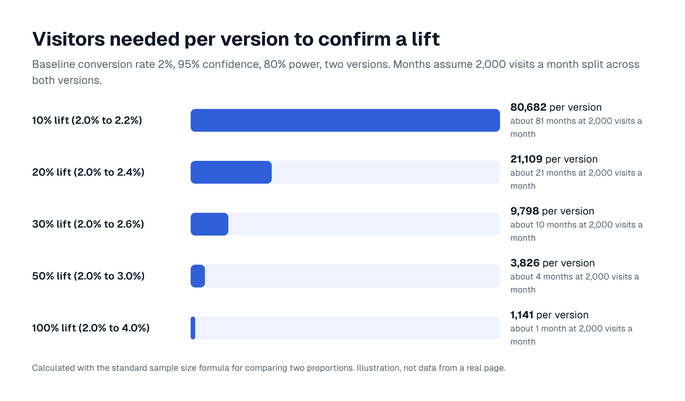
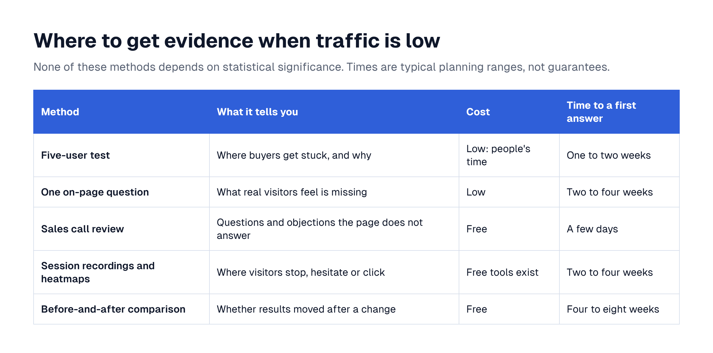
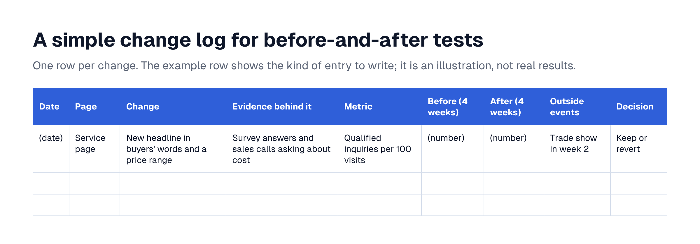
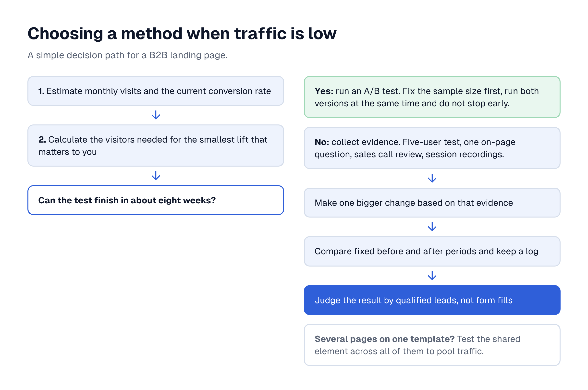

# How to Improve a B2B Landing Page When Traffic Is Too Low for A/B Tests

**By B. Vignesh, Founder & CEO, VTurnU**

Most advice on landing pages ends with the same instruction: test it. Split your traffic, run version A against version B and keep the winner. For a B2B company whose page gets a few hundred or a few thousand visits a month, that advice is hard to follow. The test never finishes, or it finishes with a "winner" that is really noise.

This article is for founders and marketers at small and midsize B2B companies who still need to make the page work harder. The short answer is to change the method, not to give up on improvement:

1. **Check the math before you test.** A two-minute calculation tells you whether a split test can finish in a reasonable time.
2. **If it cannot, collect evidence another way.** Watch five people use the page, ask visitors one question, read your sales conversations and watch session recordings.
3. **Make fewer, bigger changes** based on that evidence.
4. **Compare before and after honestly,** with fixed periods and a written log.
5. **Pool similar pages** when you have them, so one test can draw on more traffic.
6. **Judge every change by qualified leads,** not by form fills.

The rest of this article explains each step, the reasoning behind it and the mistakes to avoid.

## Why low traffic breaks A/B tests

An A/B test compares two versions of a page and asks whether the difference in conversion rate is bigger than chance would explain. The number of visitors you need depends on three things: your current conversion rate, the size of the improvement you want to detect and how sure you want to be.

Here is an illustration. Imagine a B2B landing page that turns 2% of its visitors into inquiries. Using the standard sample size formula for comparing two proportions, with 95% confidence and 80% power, this is how many visitors each version needs:

| Improvement to detect | New conversion rate | Visitors per version | Total visitors | Months at 2,000 visits a month |
|---|---|---|---|---|
| 10% | 2.2% | 80,682 | 161,364 | about 81 |
| 20% | 2.4% | 21,109 | 42,218 | about 21 |
| 30% | 2.6% | 9,798 | 19,596 | about 10 |
| 50% | 3.0% | 3,826 | 7,652 | about 4 |
| 100% | 4.0% | 1,141 | 2,282 | about 1 |

The pattern matters more than the exact numbers. Small improvements, the kind most tweaks produce, need tens of thousands of visitors to prove. A page with 2,000 visits a month would need almost two years to confirm a 20% lift. Only large changes can be confirmed within a quarter.

You can run the same calculation for your own page with a free tool such as [Evan Miller's sample size calculator](https://www.evanmiller.org/ab-testing/sample-size.html). Enter your real conversion rate and the smallest lift you would care about. If the answer is more than two or three months of traffic, a classic split test is the wrong tool for that question.

### The temptation to stop early

Low traffic creates a second problem. When a test drags on, it is tempting to check the results every few days and stop as soon as one version looks significantly better. Evan Miller's essay [How Not To Run an A/B Test](https://www.evanmiller.org/how-not-to-run-an-ab-test.html) explains why this goes wrong: if you test for significance repeatedly and stop at the first good-looking result, you will declare far more false winners than your chosen confidence level suggests. His advice is to fix the sample size in advance and not to test significance repeatedly along the way.

On a page with little traffic, that discipline is hard to keep for months. It is better to choose a method that fits the traffic you have.

There is also a practical point. Google Optimize, which many small teams used for free split tests, is gone. Google's help page confirms that Optimize and Optimize 360 were [no longer available after September 30, 2023](https://support.google.com/analytics/answer/12979939). Teams that still want split testing need another tool, which is one more reason to check the math before paying for one.

## Step 1: Collect evidence before you change anything

When you cannot measure small differences reliably, you need to find the big problems. Four sources of evidence work well on low traffic, and none of them depends on statistical significance.

### Watch five people use the page

Usability testing does not need large numbers. In [Why You Only Need to Test with 5 Users](https://www.nngroup.com/articles/why-you-only-need-to-test-with-5-users/), Jakob Nielsen of Nielsen Norman Group explains that testing with five users finds about 85% of the usability problems, based on a mathematical model he developed with Thomas Landauer. He recommends running several small rounds rather than one large one, and fixing what you find between rounds.

For a B2B landing page, recruit people who resemble your buyers: a few customers, prospects from your sales pipeline, or people in similar roles from your network. Give each person a realistic task, such as "find out whether this company can handle a project like yours, and how you would get a quote." Then watch. Note where they hesitate, what they scroll past and what they ask out loud. Do not explain the page while they use it; your explanation will not be there when real buyers visit.

Keep the limit in mind. Nielsen's figure applies to users who are similar to one another. If your page serves two very different buyers, such as a technical evaluator and a finance approver, test a few people from each group.

### Ask visitors one question

A one-question survey on the page collects evidence from people who are actually deciding. Ask something specific that a visitor can answer in a few words, for example:

- "What is stopping you from contacting us today?"
- "What information is missing from this page?"
- "What would you like to ask us before you get in touch?"

Show the question only after a visitor has spent some time on the page or scrolled most of the way down, so you hear from interested readers rather than people who arrived by mistake. Read every answer. Even a few dozen responses can point to a recurring gap, such as missing pricing information, an unclear scope, no proof of similar work or uncertainty about what happens after the form is sent.

### Read your sales conversations

Your sales team hears the questions the page failed to answer. Review the most recent first calls or email threads with prospects who came through the page. Write down every question asked in the first few minutes. Questions that appear again and again belong on the page.

Do the same with the free-text fields on your inquiry form. What people write under "Tell us about your project" shows the words they use for their problem. Those words often make a better headline than the language your team uses internally.

### Watch session recordings

Session recordings and heatmaps show where visitors stop scrolling, what they click and where they hesitate. [Microsoft Clarity](https://clarity.microsoft.com/), for example, offers session recordings and heatmaps and describes its plan as free. Recordings will not tell you why someone left, but they show you where to look. A form that many visitors start and few finish, or a section that almost nobody scrolls past, is a strong lead for your next change.

Before adding any recording tool, check your privacy notice and your consent setup, and make sure fields that may hold personal data are masked.

## Step 2: Make fewer, bigger changes

The sample size table points to a practical rule: on a low-traffic page, small changes cannot be measured. So make changes that are big enough to matter, and base them on the evidence you collected.

Changes of this size often come out of the research above:

- **Rewrite the headline in the buyer's words,** using the language from sales calls and form entries rather than internal product terms.
- **Add the proof buyers asked for,** such as examples of similar projects, the industries you work with, certifications or named reviews.
- **Answer the money question,** with a starting price, a price range or an explanation of what drives the cost.
- **Fix the form,** by removing fields nobody uses, or by adding the one question your sales team always has to ask on the first call.
- **Explain what happens next,** including who will reply, how soon and what the first conversation will cover.

If you want a structured way to review the page before choosing what to change, a section-by-section checklist such as this [B2B landing page optimization guide](https://vturnu.com/blog/landing-page-optimization-guide/) can help you work through the headline, proof, form and follow-up in order.

There is a trade-off. When you change several things at once, you learn whether the new page performs better, but not which part made the difference. On low traffic, that is usually an acceptable price. Once the big problems are fixed, you can refine the details.

## Step 3: Compare before and after, honestly

Without a split test, you will compare a period before the change with a period after it. This is weaker evidence, because many other things change over time. A few rules make it much more trustworthy:

1. **Use equal, fixed periods.** Decide in advance to compare, for example, four weeks before the change with four weeks after. Do not extend the "after" period because the numbers are close.
2. **Avoid unusual weeks.** Holidays, trade shows, a press mention or a pause in advertising can move results more than any page change. If one falls inside your window, note it or move the window.
3. **Keep traffic sources steady.** If your paid campaigns changed at the same time as the page, you cannot tell which caused the difference. Compare results within the same traffic source where you can.
4. **Write everything down.** Keep a simple log for every change: the date, what changed, the evidence behind it, the metric you will judge it by, the before and after numbers, and anything unusual that happened during the period.
5. **Keep the old version.** If the new page does worse, you want to be able to switch back quickly.

A before-and-after comparison will not give you a p-value. It gives you a documented decision based on the best evidence you have, which is what most small teams need. Over a year, the log also becomes a record of what your buyers respond to, which is useful when you build the next page.

## Step 4: Pool similar pages when you can

If you have several pages built on the same template, such as service pages, location pages or product pages, you can sometimes test one change across all of them at once. A form layout, a proof section or a call to action that appears on ten pages draws on ten pages' worth of traffic.

This works when the pages share a purpose and an audience. Change the element that is the same everywhere, keep everything else as it was, and judge the result across the whole group. It does not work for elements that are unique to each page, such as headlines, and it can mislead you if one page in the group behaves very differently from the rest. Check the results page by page as well as in total.

## Step 5: Judge changes by qualified leads, not form fills

On low traffic, the temptation is to measure whatever moves fastest: button clicks, form starts, time on page. These signals can help you spot problems, but they are not the result you want. A change that doubles form submissions while halving their quality is not an improvement.

Agree with your sales team on what counts as a qualified inquiry, and track that number for the page alongside total submissions. If you can, also track how many qualified inquiries turn into first meetings. These numbers are smaller and slower, but they are the ones that pay for the page.

## When an A/B test is still worth running

Low traffic does not rule out split tests completely. A test is worth running when:

- The calculation shows it can finish in about eight weeks or less.
- You are testing a large change, where the expected effect is big enough to detect.
- The traffic sources will stay steady for the whole test, including any paid campaigns.

When those conditions hold, fix the sample size before you start, run both versions at the same time and do not stop early.

## Summary

A B2B landing page with modest traffic can still improve steadily. Only the method changes:

- Calculate before you test, so you know whether a split test can finish.
- Learn from five users, one on-page question, your sales conversations and session recordings.
- Make fewer, bigger changes based on that evidence.
- Compare fixed before-and-after periods, and keep a written log.
- Pool similar pages where you can.
- Judge everything by qualified leads.

Small teams rarely have the traffic for constant testing. What they usually do have is direct access to buyers and to the people who talk to them every day. Used carefully, that is a strong source of evidence.

---

*B. Vignesh is the Founder & CEO of VTurnU, a B2B digital marketing and web development company based in Chennai, India. He has worked in digital marketing since 2017 and started VTurnU in 2020.*

Email: connect@vturnu.com · LinkedIn: [linkedin.com/in/vigneshuday](https://www.linkedin.com/in/vigneshuday/)

===META===
Title: How to Improve a B2B Landing Page When Traffic Is Too Low for A/B Tests
Meta title: B2B Landing Page Testing When Traffic Is Too Low for A/B Tests
Meta description: Too few visitors for a split test? Check the math, collect evidence from five users, one on-page question, sales calls and recordings, then make bigger changes and judge them by qualified leads.
Keywords: low traffic A/B testing, B2B landing page optimization, sample size, conversion rate optimization, qualified leads
Primary reader: founders and marketers at small and midsize B2B companies with limited landing page traffic
Featured image: growthfolks-low-traffic-landing-page-testing.jpg (1200 x 675)
Visuals: visual-1.png (sample size chart), visual-2.png (evidence sources), visual-3.png (change log), visual-4.png (decision path), all created for this article
Link of the author's choice (one, dofollow, as agreed): https://vturnu.com/blog/landing-page-optimization-guide/ (Step 2)
Sources: Evan Miller, sample size calculator and "How Not To Run an A/B Test"; Google Analytics Help, "[Sunset September 2023] Google Optimize"; Nielsen Norman Group, "Why You Only Need to Test with 5 Users"; Microsoft Clarity product page. Sample sizes calculated with the standard two-proportion formula (95% confidence, 80% power).
Disclosure: the author runs a B2B digital marketing and web development company. No sponsorship or affiliate links.
Exclusive: written for GrowthFolks and not published anywhere else.
